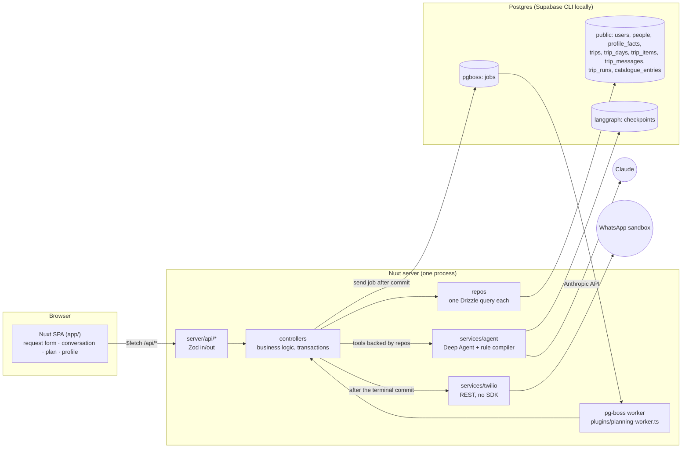
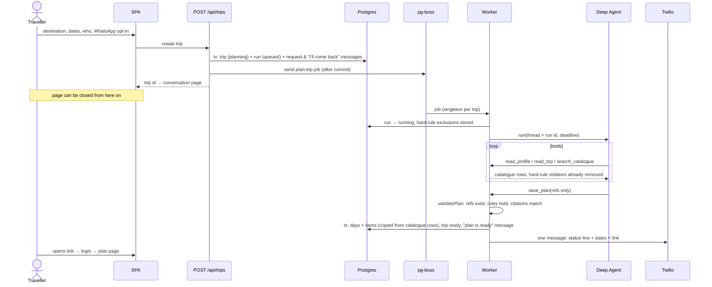

# Architecture overview

A traveller describes a trip and gets an immediate reply: "I'll plan this trip and come back to you. I won't book or charge anything." They can close the page. A background agent plans the trip from the traveller's knowledge graph and a fixture catalogue, then writes the plan into the trip. One WhatsApp message with a link goes out when the plan is ready or has failed. Nothing is ever booked or paid.

Deeper docs: the run lifecycle and its failure modes are in `server/controllers/shared/planning/README.md`, rule compilation in `server/controllers/knowledge-graph/compileFactRule/README.md`, and the layer rules in `CLAUDE.md`, `server/CLAUDE.md` and `app/CLAUDE.md`.

## Components

Dependencies only point one way: route → controller → repo → database. Services wrap third parties and never touch the database. The agent service gets its tools from the controller as plain functions, so it never imports a repo.

## One planning run

A run that can't produce a valid plan takes the same path to `failed`. That covers an error, the deadline with no saved plan, no catalogue options, or a hard rule that leaves nothing. The run then writes a templated "I couldn't finish this plan" message and sends the failed WhatsApp message.

## Guarantees and where they are enforced

| Guarantee | Enforced by |
|---|---|
| **Background run.** Planning outlives the HTTP request and the open page | `createTrip.ts` commits, then `enqueuePlanRun.ts` sends a pg-boss job. The worker runs in the server process (`startPlanningWorker.ts`). A crash leaves the job to heartbeat recovery, which resumes from the LangGraph checkpoint. Boot re-queues runs that never got a job |
| **Never stuck in `planning`.** Every run ends `ready` or `failed` | `runPlanTripJob.ts` catches every exit into `failRun`. `finishRun` and `failRun` both start with the conditional `finishTripRun`, so only one of them wins. A deadline stops the agent |
| **No invented facts.** Every place, time and price comes from the catalogue or the trip | `save_plan` accepts catalogue refs, not names (`SavePlanInput.ts`). `placeItems.ts` rejects unknown refs and takes transport and stay times from the catalogue. `finishRun.ts` copies name, price and times from the catalogue row. A missing fact is stored as a gap and shown as "not in catalogue". Conversation messages are templates (`runMessages.ts`), never agent text |
| **Hard constraints remove, preferences rank** | When a fact is saved, its text is compiled once into a rule and checked against worked examples (`compileFactRule/`). `evaluateRule.ts` is the only evaluator. Violators are filtered out of tool results (`buildPlanningTools.ts`) and checked again on save (`placeItems.ts`), and every removal is disclosed on the plan. Preferences only order results, and a cited preference must really match |
| **Never invent preferences** | The agent reads only `profile_facts`. Citing a fact id that isn't stored is rejected. A "why" that cites no preference has to say so (`placeItems.ts`) |
| **Nothing booked or paid** | The agent has four tools: `read_profile`, `read_trip`, `search_catalogue`, `save_plan`. None books, pays or contacts a provider. Deep Agents' built-in filesystem and sub-agent tools are removed (`agent.service.ts`) |
| **Edits are input** | Day edits are saved on the trip (`updateTripDay.ts`) and locked while a run is planning. `read_trip` shows removed items and notes. Re-adding a removed item must be explicit (`readdsRemoved`) |
| **WhatsApp: one message, link only** | `onRunFinished.ts` sends after the terminal commit, only with opt-in and a number. The text holds status, dates and the link (`whatsappMessage.ts`), never names, places or prices. The outcome is recorded per run |

## Stack choices

| Choice | Why |
|---|---|
| **Nuxt 4** (SPA + Nitro server) | One TypeScript codebase for UI and API, with typed `$fetch` from server routes to the FE and no separate backend deploy |
| **LangGraph Deep Agents** | Required by the brief. Used deliberately thin: four tools, no filesystem or sub-agents. A Postgres checkpointer lets a crashed run resume |
| **pg-boss** | A durable queue in the database we already run: no Redis, retries and dead-lettering included. The job is sent after the trip commits, so a job never points at a missing trip |
| **Postgres + Drizzle** | Relational trip, day and item model with typed queries and generated migrations. The knowledge graph is plain tables (people, facts, edges by subject), which is enough for one traveller's graph |
| **Zod v4** | The same schemas validate the FE form, the API boundary and the agent's tool input |
| **Supabase** (Auth + Postgres only) | Email/password auth out of the box. Local and deployed stacks match |
| **Twilio WhatsApp sandbox**, plain REST | Free test channel. One POST doesn't justify an SDK |
| **Claude Sonnet** (planner), **Haiku** (rule compiler) | Planning needs tool use over long catalogue results. Compiling a rule is one small structured call |
| **Fly.io**, one always-on machine | The worker lives in the web process, so the machine must not scale to zero mid-run |
